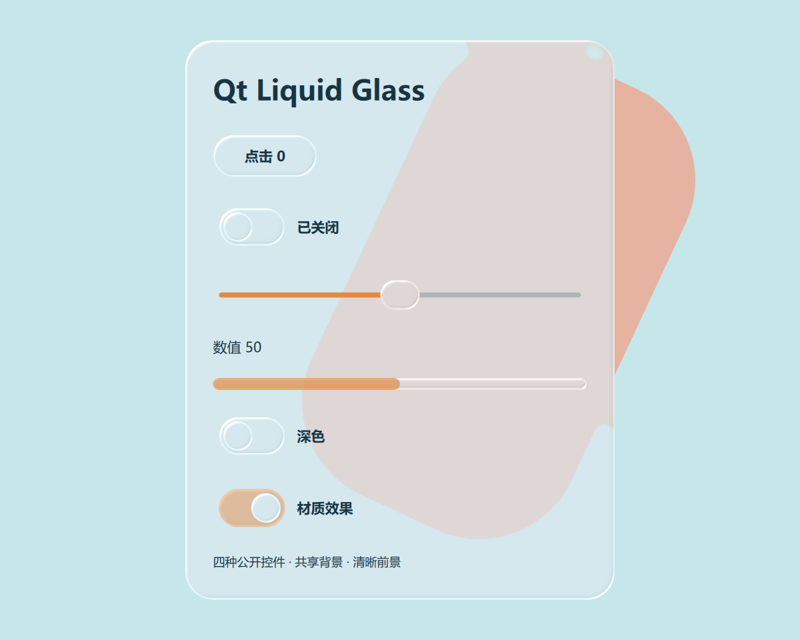

# Qt Liquid Glass

Qt Quick / PyQt6 玻璃材质与基础控件参考项目。提供按钮、开关、水平滑块、进度条和默认 GlassScene 容器，适合自有背景上的桌面应用原型。

## 快速开始

需要 Python 3.10 或更新版本；本次验证使用 Python 3.11.9。Windows PowerShell 在仓库根目录执行：

```powershell
python -m venv .venv
.\.venv\Scripts\python.exe -m pip install -r requirements.txt
.\.venv\Scripts\python.exe examples/minimal.py
```

最小示例直接导入 qml/，展示四种真实组件、主题和效果开关，背景由程序生成。启动脚本可用绝对路径从其他工作目录运行。Linux/macOS 运行方式类似，但图形效果尚未验证。



[约24秒动态演示](docs/demo.gif)（按压、滑块、开关、深浅色与效果回退）

## 接入

```qml
import QtQuick
import "path/to/qml"
GlassScene {
    id: scene
    width: 800; height: 640
    accent: "#407be0"
    GlassButton { theme: scene; text: "确定"; onClicked: console.log("clicked") }
    GlassSwitch { y: 60; theme: scene; text: "开关" }
    GlassSlider { id: slider; y: 120; theme: scene; from: 0; to: 100; value: 50 }
    GlassProgress { y: 180; theme: scene; value: slider.value / 100 }
}
```

[组件参数与限制](docs/components.md) · [验证记录](docs/validation.md) · [架构](docs/architecture.md) · [来源与依赖](docs/sources.md) · [完成清单](docs/completion.md)

## 验证与构建

```powershell
.\.venv\Scripts\python.exe examples/minimal.py --test
```

测试失败返回非零退出码，输出到 data/verification。覆盖真实 GPU 渲染、交互、键盘、禁用、主题、父级变换的像素对齐与裁剪。软件后端不作为 GPU 验收。固定 PyQt6 6.11.0、Qt 6.11.0，其他版本没有支持承诺。

GLSL 源码与 qsb 同时保留。运行无需 qsb，修改源码后使用 Qt Shader Tools 6.11.0：

```sh
python tools/build_shaders.py --qsb /path/to/qsb
```

[构建版本与哈希](docs/shader-build.json)。可选 GIF 录制工具需要 Pillow：`python tools/record_demo.py`。

## 发布范围

| 状态 | 内容 |
| --- | --- |
| 已提供 | GlassScene、Prism、Lens、FrostedBackdrop、四种基础控件和示例 |
| 仅架构说明 | Windows WGC 桌面捕获、共享磨砂与局部透镜组合 |
| 留待后续 | ComboBox、Avatar、CapsuleSelector、更多平台和多 DPI |

进阶材质比较工具：`python examples/glass_lab.py`。它保留独立展示实现，不能代替公开控件的测试。重复 Shader/Lens 的维护关系见架构说明。

## 许可证

自有代码与生成素材使用 [MIT](LICENSE)。PyQt6、Qt、Pillow 和系统字体遵循各自授权；MIT 不改变外部运行时的分发要求，见[来源说明](docs/sources.md)。
