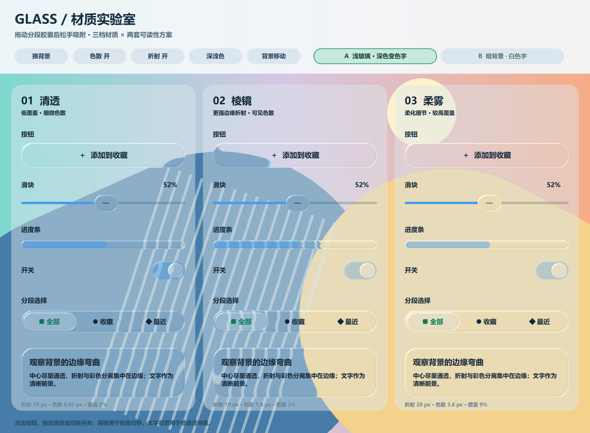

# Qt Liquid Glass

Qt Quick / PyQt6 玻璃材质与基础控件参考项目。提供按钮、开关、滑块、进度条和默认 GlassScene 容器。

## 快速开始

在仓库根目录执行：

```sh
python -m pip install PyQt6==6.11.0
python examples/minimal.py
python examples/minimal.py --test
```

最小示例直接导入 qml/，展示四种真实组件、主题和效果开关。程序生成背景，无外部资源。启动脚本也可使用绝对路径从任意目录运行。

## 接入

```qml
import QtQuick
import "path/to/qml"
GlassScene {
    id: scene
    width: 800; height: 600
    GlassButton { theme: scene; text: "确定"; onClicked: console.log("clicked") }
    GlassSwitch { y: 60; theme: scene; text: "开关"; onToggled: console.log(checked) }
    GlassSlider { id: slider; y: 120; theme: scene; from: 0; to: 100; value: 50 }
    GlassProgress { y: 180; theme: scene; value: slider.value / 100 }
}
```

[组件与支持范围](docs/components.md) · [原应用架构研究](docs/architecture.md)

## 材质实验室

```sh
python examples/glass_lab.py
```

实验室使用独立展示实现，用于比较光学参数。其测试不能替代 minimal.py 的公开控件检查。



## 发布范围

| 状态 | 内容 |
| --- | --- |
| 已提供 | GlassScene、Prism、Lens、FrostedBackdrop、四种基础控件及示例 |
| 仅架构说明 | Windows WGC 桌面捕获与原应用集成 |
| 未提供 | ComboBox、Avatar、CapsuleSelector 的独立组件 |

本机 Python 3.11.9 / PyQt6、Qt 6.11.0 曾通过 Windows D3D11 检查。依赖允许范围不表示所有版本经过验证，推荐上述固定版本。其他平台未验证。

GLSL 和 qsb 同时保留；使用匹配 Qt 的 qsb 构建，例如：

```sh
qsb --glsl "100 es,120,150" --hlsl 50 --msl 12 -o qml/lens.frag.qsb qml/lens.frag
```

既有 qsb 的确切构建工具版本未记录。本项目尚未指定许可证；公开可见不等同于已授予开源使用授权。来源与授权核对完成后再发布正式版本。
